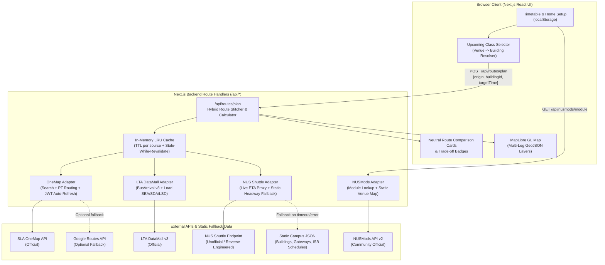

# System, Data & Route-Calculation Architecture (`ARCHITECTURE.md`)

## 1. Recommended Hackathon Stack

To maximize development velocity and demo reliability while keeping infrastructure minimal, the project uses a **single unified TypeScript repository**:

- **Frontend Framework:** **Next.js 14+ (App Router) with React 18, TypeScript, and Tailwind CSS**
  - *Rationale:* Zero-config file-system routing, fast UI iteration with Tailwind + Lucide icons, and shared TypeScript interfaces between the React client and backend route handlers.
- **Backend Framework:** **Next.js Server Route Handlers (`src/app/api/*/route.ts`)**
  - *Rationale:* Executes server-side within the same repository—protects secret credentials (`LTA_ACCOUNT_KEY`, `ONEMAP_EMAIL`, `ONEMAP_PASSWORD`, `GOOGLE_MAPS_API_KEY`), eliminates browser CORS issues against LTA/OneMap/NUS endpoints, and deploys as one unit.
- **Map Library:** **MapLibre GL JS (`maplibre-gl` + `react-map-gl`)** using **OneMap Default/Night Basemap Tiles** (or OpenStreetMap raster tiles)
  - *Rationale:* 100% open-source, requires no credit card or Mapbox token, renders multi-leg GeoJSON polylines smoothly, and provides authoritative Singapore building/road footprints.
- **Database / Local-Storage Approach:** **Stateless Backend + Browser `localStorage` + Curated Static JSON Registry**
  - *User state* (home location, imported timetable, custom classes, user-selected route reminders) persists in browser `localStorage` validated with Zod—zero database provisioning or user authentication required.
  - *Reference campus data* (curated NUS buildings, NUSMods classroom coordinates, NUS shuttle stops/routes/headways, and public-to-ISB gateway transfer hubs) lives in versioned static JSON files (`src/data/*.json`).
- **Deployment Platform:** **Vercel** (or Render / Railway via `npm run build && npm run start`).

---

## 2. Directory Structure & Routing Architecture

```text
src/
├── app/
│   ├── api/
│   │   ├── location/search/route.ts       # OneMap address/postal geocoding
│   │   ├── nusmods/module/[code]/route.ts # Cached NUSMods module proxy
│   │   └── routes/plan/route.ts           # Main hybrid route generation & stitching endpoint
│   ├── layout.tsx
│   └── page.tsx                           # Main 2-column commute planner workspace
├── components/
│   ├── common/                            # ProvenanceBadge, CrowdingPill, FallbackBanner
│   ├── map/                               # CommuteMap (MapLibre GL + multi-leg GeoJSON layers)
│   ├── routes/                            # RouteComparisonList, RouteCard, RouteDetailTimeline
│   ├── setup/                             # HomeLocationInput, DemoTimeOverride
│   └── timetable/                         # TimetableModal (NUSMods/.ics/manual), UpcomingClassesStrip
├── data/
│   ├── nus-buildings.json                 # Curated NUS buildings & nearest stop mappings
│   ├── nus-gateways.json                  # Public transit <-> NUS ISB transfer hubs
│   ├── nus-shuttles.json                  # ISB routes (A1, A2, D1, D2, K, E, BTC, L), stops & headways
│   ├── nusmods-venues-subset.json         # Classroom coordinates from NUSMods venues.json
│   └── fixtures/                          # Recorded snapshots for offline/demo resilience
├── lib/
│   ├── adapters/                          # Typed clients for OneMap, LTA v3, NUS Shuttle, Google Routes
│   ├── cache/                             # In-memory LRU cache with provenance timestamps
│   ├── campus/                            # Venue-to-building resolver
│   ├── routing/                           # Gateway stitcher & deterministic time/range calculator
│   └── timetable/                         # NUSMods share URL & .ics parsers
└── types/
    └── commute.ts                         # Shared normalized TypeScript schemas
```

### System Data Flow



---

## 3. External API Audit, Caching & Error Handling

### 3.1 Audited Data Sources

| Data Source | Classification | Access & Authentication | Reliability | Terms & Constraints | Fallback Strategy |
| :--- | :--- | :--- | :--- | :--- | :--- |
| **NUSMods API v2 & Venue Dataset** (`https://api.nusmods.com/v2/`) | **Community-Operated** (Student-run open-source project supported by NUS) | Public, unauthenticated static JSON over HTTPS (`GET /v2/{acadYear}/modules/{moduleCode}.json`). Classroom coordinates (`x: lon, y: lat`, `floor`, `roomName`) from `website/src/data/venues.json` in `nusmodifications/nusmods`. | **Very High** (Cloudflare CDN static JSON, updated daily). | MIT License / free academic & student use. | Bundled static `nusmods-venues-subset.json` & manual building selector. |
| **NUS Shuttle Bus APIs** (`fms.connectx.com.sg/apiy/NUSETA` / `myizaac2.nus.edu.sg` / legacy `nnextbus.nus.edu.sg`) | **Reverse-Engineered / Unofficial** (Internal APIs for uNivUS / NextBus mobile apps; documented by community repos like `SuibianP/nus-nextbus-new-api`) | Legacy `nnextbus.nus.edu.sg` is retired. Active uNivUS backend requires app headers (`X-HTD-API`, `X-APP-API`) for a 24h JWT (`/univus-public/mobile/get-access-token`), then queries `/ShuttleService?busstopname=...`. | **Low-to-Medium** for third-party access. Undocumented and subject to header/token rotation. | NUS Acceptable Use Policy (AUP). Must never be a single point of failure. | Wrapped behind a `2500ms` timeout; automatically falls back to deterministic **Static NUS ISB Headway & Ride-Time Matrix** (`Using scheduled timetable`). |
| **LTA DataMall v3** (`https://datamall2.mytransport.sg/ltaodataservice/`) | **Official Government API** (Land Transport Authority) | Free registration; requires `AccountKey` header on `GET /v3/BusArrival?BusStopCode={code}&ServiceNo={no}`. Returns `EstimatedArrival`, `Load` (`SEA`/`SDA`/`LSD`), `Monitored` (`0`/`1`), `Feature` (`WAB`), `Type` (`SD`/`DD`/`BD`). | **High** (Refreshed every 20–60s; individual buses may have `Monitored: 0`). | Singapore Open Data Licence v1.0. Attribution required; keep key server-side. | Retains OneMap scheduled bus durations and marks `Live arrival data unavailable` + `Crowding information unavailable`. |
| **SLA OneMap API** (`https://www.onemap.gov.sg/api/`) | **Official Government API** (Singapore Land Authority) | Search API (`/api/common/elastic/search`) is public. Routing API (`/api/public/routingsvc/route?routeType=pt`) requires `POST /api/auth/post/getToken` with `ONEMAP_EMAIL` & `ONEMAP_PASSWORD` to obtain a 3-day Bearer JWT. | **High** (OpenTripPlanner backed by LTA GTFS; ~250 req/min). | Singapore Open Data Licence / SLA OneMap Terms. | Auto-refreshes JWT on 401; optional fallback to Google Routes API or pre-cached demo corridors. |
| **Google Maps Routes API** (`https://routes.googleapis.com/directions/v2:computeRoutes`) | **Official Commercial Third-Party API** | GCP API Key (`X-Goog-Api-Key`) + `X-Goog-FieldMask` with `travelMode: "TRANSIT"`. | **Very High** | Google Maps Platform ToS. | Used strictly as an optional fallback when OneMap PT fails. |
| **NUS Campus Spatial / Digital Twin Data** | **Internal Enterprise vs. Open Community Data** | Enterprise NUS UCI Digital Twin has no public API. We combine open **NUSMods `venues.json`** coordinates with **OpenStreetMap (OSM)** / NUS Urban Analytics Lab building centroids. | **Static / Curated** (100% available offline). | ODbL (OSM) & MIT (NUSMods). | Static local lookup in `src/data/nus-buildings.json` (0ms latency). |

### 3.2 Caching Strategy (Server `lru-cache`)

| Data Type | Cache Layer | Fresh TTL | Stale-While-Revalidate Window |
| :--- | :--- | :--- | :--- |
| **NUSMods Module & Venue JSON** | Server LRU + `localStorage` | 24 hours | 7 days |
| **OneMap Geocoding Search** | Server LRU | 24 hours | 7 days |
| **OneMap PT Base Itineraries** | Server LRU | 5 minutes | 30 minutes |
| **LTA BusArrival v3 (Live ETA & Load)** | Server LRU | 20 seconds | 90 seconds |
| **NUS Shuttle Live Arrivals** | Server LRU | 15 seconds | 60 seconds |

---

## 4. Normalized Data Schemas (`src/types/commute.ts`)

```typescript
export type DataStatus = 'LIVE' | 'CACHED' | 'SCHEDULED' | 'ESTIMATED' | 'UNAVAILABLE';

export interface DataProvenance {
  source:
    | 'LTA_DATAMALL_V3'
    | 'ONEMAP_PT'
    | 'NUS_NEXTBUS_LIVE'
    | 'NUS_STATIC_SCHEDULE'
    | 'GOOGLE_ROUTES'
    | 'NUSMODS_STATIC';
  sourceCategory: 'OFFICIAL' | 'COMMUNITY' | 'REVERSE_ENGINEERED' | 'STATIC_FALLBACK';
  status: DataStatus;
  fetchedAt: string | null;       // ISO 8601 timestamp
  ageSeconds: number | null;      // Seconds since fetchedAt
  isStale: boolean;               // True if ageSeconds > fresh TTL
  warningMessage?: string;        // e.g., "Live arrival data unavailable — Using scheduled timetable"
}

export type OfficialLoadCode = 'SEA' | 'SDA' | 'LSD'; // Seats Available, Standing Available, Limited Standing

export interface CrowdingInfo {
  status: 'OFFICIAL_LIVE' | 'UNAVAILABLE';
  loadCode?: OfficialLoadCode;
  label:
    | 'Seats Available (SEA)'
    | 'Standing Available (SDA)'
    | 'Limited Standing (LSD)'
    | 'Crowding information unavailable';
  vehicleType?: 'SD' | 'DD' | 'BD';
  isWheelchairAccessible?: boolean;
  provenance: DataProvenance;
}

export interface TransitStop {
  id: string;                     // e.g., "LTA_18331", "MRT_CC24", "NUS_KR-MRT"
  code: string;                   // "18331", "CC24", "KR-MRT"
  name: string;                   // "Kent Ridge Stn Exit A / NUH"
  network: 'LTA_BUS' | 'SMRT_SBS_MRT' | 'NUS_ISB';
  lat: number;
  lon: number;
  gatewayHubId?: string;
}

export interface NusBuilding {
  buildingId: string;             // e.g., "COM1", "AS6", "UTSRC", "S17", "BIZ2"
  buildingName: string;           // "Computing 1 (School of Computing)"
  zone: 'COM_BIZ' | 'FASS' | 'UTOWN' | 'SCIENCE_MED' | 'ENGINEERING' | 'USC_YIH';
  lat: number;
  lon: number;
  nearestNusStopIds: {
    stopId: string;
    walkDistanceMeters: number;
    walkDurationSeconds: number;
    hasSlopeOrStairs: boolean;
  }[];
  nearestExternalStopIds: {
    stopId: string;
    walkDistanceMeters: number;
    walkDurationSeconds: number;
  }[];
}

export interface TimetableLesson {
  id: string;                     // "CS2103T-LEC-1"
  moduleCode: string;             // "CS2103T"
  moduleTitle?: string;           // "Software Engineering"
  lessonType: string;             // "LEC", "TUT", "LAB", "SEC"
  classNo: string;                // "1"
  dayOfWeek: 'Monday' | 'Tuesday' | 'Wednesday' | 'Thursday' | 'Friday' | 'Saturday';
  startTime: string;              // "10:00"
  endTime: string;                // "12:00"
  weeks: number[];
  rawVenue: string;               // "COM1-0212"
  resolvedBuildingId: string | null;
  venueLat?: number;
  venueLon?: number;
}

export interface NusShuttleRoute {
  serviceCode: 'A1' | 'A2' | 'D1' | 'D2' | 'K' | 'E' | 'BTC' | 'L';
  description: string;
  stopSequence: {
    stopId: string;
    cumulativeRideSeconds: number;
  }[];
  headways: {
    weekdayPeakSeconds: [number, number];    // e.g., [240, 420]
    weekdayOffPeakSeconds: [number, number]; // e.g., [480, 720]
    saturdaySeconds: [number, number];
    sundayOrNoService: [number, number] | null;
  };
}

export type LegMode = 'WALK' | 'PUBLIC_BUS' | 'MRT' | 'NUS_SHUTTLE' | 'TRANSFER_WAIT';

export interface RouteLeg {
  legIndex: number;
  mode: LegMode;
  serviceName?: string;           // "96", "EWL", "D1"
  operator?: 'SBS' | 'SMRT' | 'TTS' | 'GAS' | 'NUS_ISB';
  fromName: string;
  fromStopCode?: string;
  fromCoords: [number, number];   // [lat, lon]
  toName: string;
  toStopCode?: string;
  toCoords: [number, number];     // [lat, lon]
  distanceMeters: number;
  durationSeconds: number;
  durationRangeSeconds: [number, number];
  waitTimeSeconds: number;
  waitTimeRangeSeconds: [number, number];
  stopCount?: number;
  polylineGeoJson: [number, number][]; // [lon, lat]
  crowding: CrowdingInfo;
  provenance: DataProvenance;
}

export interface CommuteRoute {
  routeId: string;
  summaryTitle: string;
  neutralTags: (
    | 'Fastest by estimate'
    | 'Fewest transfers'
    | 'Least walking'
    | 'Lowest reported crowding'
    | 'More data available'
  )[];
  departureTimeIso: string;
  estimatedArrivalIso: string;
  arrivalRangeIso: {
    earliestIso: string;
    latestIso: string;
    uncertaintyMinutes: number;
  };
  arrivesAfterClassStart: boolean;
  metrics: {
    totalDurationSeconds: number;
    totalDurationRangeSeconds: [number, number];
    totalWalkSeconds: number;
    totalWalkMeters: number;
    totalWaitSeconds: number;
    totalWaitRangeSeconds: [number, number];
    totalInVehicleSeconds: number;
    transferCount: number;
    publicServicesUsed: string[];
    nusShuttlesUsed: string[];
  };
  legs: RouteLeg[];
  warnings: string[];
  overallFreshness: {
    liveLegsCount: number;
    scheduledLegsCount: number;
    lastUpdatedIso: string;
  };
}
```

---

## 5. Gateway Transfer Hub Graph (Public Transit $\leftrightarrow$ NUS Shuttle)

| Gateway Hub ID | External Public Stop(s) | Connected NUS Shuttle Stop(s) | NUS Shuttles Served | Transfer Walk & Buffer | Campus Zones Served |
| :--- | :--- | :--- | :--- | :--- | :--- |
| **`HUB_KR_MRT`** | Kent Ridge MRT (`CC24` Exit A) / Bus Stop `18331` | `NUS_KR-MRT` & `NUS_OPP-KR-MRT` | `A1`, `A2`, `D2`, `K` | 65m covered walk (90s walk + 60s buffer) | COM1/2/3, BIZ1/2, Central Library, FASS (AS1–8), Science (S17/LT27), PGP |
| **`HUB_UTOWN`** | Dover Rd / Clementi Rd Stops (`19051` / `19059` / `17091`) | `NUS_UTOWN` (University Town) | `D1`, `D2`, `E` | 180m walk (150s walk + 60s buffer) | UTown, COM1/2/3 (`D1`), Science/Med (`D2`), FASS/Engineering (`D1`/`E`) |
| **`HUB_CLEMENTI_96`** | Clementi MRT (`EW23`) $\rightarrow$ Bus `96` to `NUS_CLB` / `NUS_IT` | `NUS_IT` / `NUS_CENLIB` | `A1`, `A2`, `D1`, `K`, `E` | Same stop / 30m walk (45s walk + 45s buffer) | Engineering, YIH, Central Library, FASS, COM1/2/3 |
| **`HUB_OPP_UHC`** | Bus Stop `18309` (Opp University Hall, AYE) / `18301` | `NUS_UHC` / `NUS_OPP-UHC` | `A1`, `A2`, `D2`, `K` | 120m walk (110s walk + 60s buffer) | Administration, Science, Medicine, Central Library |
| **`HUB_KV_BIZ`** | Bus Stop `16091` / `16099` (Heng Mui Keng Terr / Opp HSSML) | `NUS_BIZ2` / `NUS_TCOMS` | `A1`, `A2`, `D1`, `D2` | 90m walk (80s walk + 60s buffer) | BIZ1, BIZ2, COM1, COM2, COM3, I3 |

---

## 6. Deterministic Route Calculation Design

All calculations are executed deterministically in `src/lib/routing/calculator.ts`. AI models are **never** used for time arithmetic, and crowding levels **never** alter route durations.

1. **Walking Time ($T_{\text{walk}}$):**
   - External pedestrian legs: $T_{\text{walk}} = \lceil d_{\text{walk}} / 1.25 \rceil$ seconds ($4.5\text{ km/h}$).
   - Campus walking legs: $T_{\text{walk,campus}} = \lceil (d_{\text{campus}} / 1.25) \times \alpha_{\text{terrain}} \rceil$, where $\alpha_{\text{terrain}} = 1.2$ for uphill/stair segments and $1.0$ otherwise.
   - Range: $[0.90 \cdot T_{\text{walk}},\; 1.15 \cdot T_{\text{walk}}]$.

2. **Waiting Time ($T_{\text{wait}}$):**
   - **Live Telemetry (`status === 'LIVE'`):** Uses live arrival timestamps $t_{\text{bus},1}, t_{\text{bus},2}$. If arriving at stop with $\ge 60\text{s}$ margin before $t_{\text{bus},1}$, $T_{\text{wait}} = \max(60, t_{\text{bus},1} - t_{\text{reach}})$ with range $[\max(0, T_{\text{wait}} - 60),\; T_{\text{wait}} + 120]$. If within $\pm 60\text{s}$ of $t_{\text{bus},1}$ (missed-bus risk), upper bound extends to $t_{\text{bus},2} - t_{\text{reach}}$.
   - **Scheduled / Static Headway (`status === 'SCHEDULED'`, headway $[H_{\min}, H_{\max}]$):**
     $$\bar{H} = \frac{H_{\min} + H_{\max}}{2}, \qquad T_{\text{wait}} = 0.5 \cdot \bar{H}, \qquad \left[T_{\text{wait}}^{\min}, T_{\text{wait}}^{\max}\right] = \left[0.2 \cdot H_{\min},\; H_{\max}\right]$$

3. **Public Vehicle Travel Time ($T_{\text{ride,public}}$):**
   - **MRT:** Base GTFS duration $T_{\text{MRT}}$, range $[0.95 \cdot T_{\text{MRT}},\; 1.05 \cdot T_{\text{MRT}} + 60]$.
   - **Public Bus:** Base GTFS duration $T_{\text{bus}}$ across $n_{\text{stops}}$, range $[0.90 \cdot T_{\text{bus}},\; 1.20 \cdot T_{\text{bus}} + 15 \cdot n_{\text{stops}}]$.

4. **Transfer Time ($T_{\text{transfer}}$):**
   - Explicitly separated into physical hub walk $T_{\text{walk,hub}}$, station-navigation buffer $T_{\text{buffer,hub}} = 60\text{s}$, and next-vehicle wait $T_{\text{wait},k+1}$:
     $$T_{\text{transfer}} = T_{\text{walk,hub}} + T_{\text{buffer,hub}} + T_{\text{wait},k+1}$$

5. **NUS Shuttle Travel Time ($T_{\text{ride,shuttle}}$):**
   - Difference in cumulative baseline ride seconds between boarding stop index $a$ and alighting stop index $b$:
     $$T_{\text{ride,shuttle}} = \text{CumulativeSeconds}(S, b) - \text{CumulativeSeconds}(S, a)$$
   - Range: $[0.90 \cdot T_{\text{ride,shuttle}},\; 1.25 \cdot T_{\text{ride,shuttle}} + 20 \cdot (b - a)]$.

6. **Total Journey Duration & Arrival-Time Range:**
   - Total duration:
     $$T_{\text{total}} = \sum T_{\text{walk}} + \sum T_{\text{buffer,hub}} + \sum T_{\text{wait}} + \sum T_{\text{ride,public}} + \sum T_{\text{ride,shuttle}}$$
   - Wait uncertainties add linearly (to reflect transfer connection risk), while independent ride/walk variances combine via root-sum-of-squares:
     $$\Delta_{\text{total}}^{-} = \sum_{i \in \text{Waits}} \Delta_i^{-} + \sqrt{\sum_{j \in \text{Rides,Walks}} \left(\Delta_j^{-}\right)^2}, \qquad \Delta_{\text{total}}^{+} = \sum_{i \in \text{Waits}} \Delta_i^{+} + \sqrt{\sum_{j \in \text{Rides,Walks}} \left(\Delta_j^{+}\right)^2}$$
     $$t_{\text{arr}}^{\min} = t_{\text{dep}} + T_{\text{total}} - \Delta_{\text{total}}^{-}, \qquad t_{\text{arr}}^{\max} = t_{\text{dep}} + T_{\text{total}} + \Delta_{\text{total}}^{+}$$

